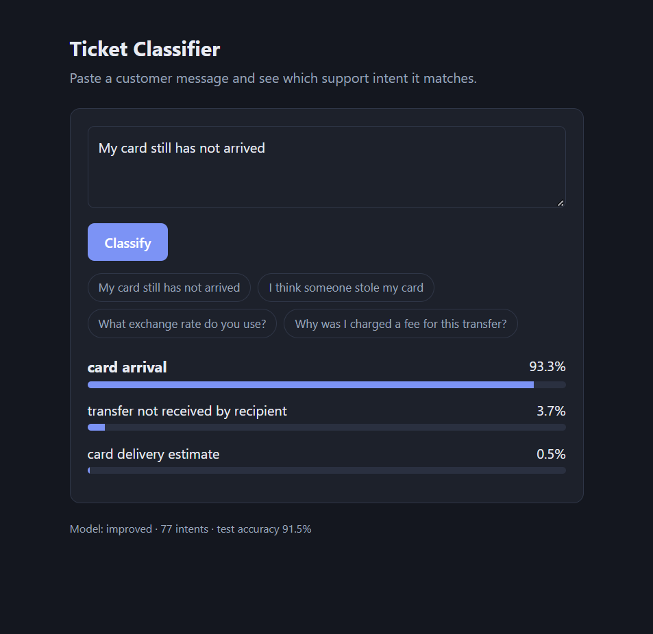
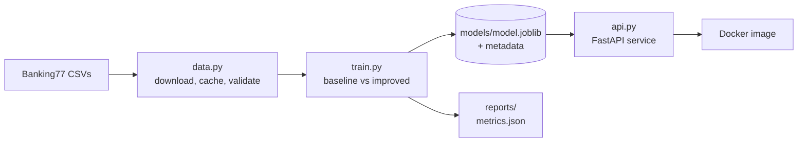

# Ticket Classifier

[](https://github.com/Tumioz/ticket-classifier/actions/workflows/ci.yml)


An end-to-end machine learning service that classifies customer-support queries into one of
77 intents (e.g. `card_arrival`, `lost_or_stolen_card`, `exchange_rate`). It covers the full
path from raw data to a tested, containerised API, not just a notebook.

<p align="center">
  
</p>

**Why this project?** Routing support tickets automatically is a common real-world ML task. The
goal here is less about squeezing out the last point of accuracy and more about showing the
engineering around the model: reproducible training, honest evaluation, a validated API, tests
and CI.

## Architecture



## Quickstart

### Easiest: no commands to remember

1. Install [Python 3.11+](https://www.python.org/downloads/). On Windows, tick "Add python.exe
   to PATH" in the installer.
2. Double-click **`start.bat`** (Windows) or run **`./start.sh`** (macOS/Linux).

The first run sets up a virtual environment, downloads the dataset and trains the model (this can
take a few minutes and needs internet once). After that it opens the web interface in your
browser: type a customer message, click **Classify**, and see the top matching intents with
confidence bars. Close the window or press Ctrl+C to stop. The same thing is available as
`python -m ticket_classifier`.

### macOS / Linux

```bash
git clone https://github.com/Tumioz/ticket-classifier.git
cd ticket-classifier
python -m venv .venv && source .venv/bin/activate
make install        # installs the package with dev dependencies
make train          # downloads the dataset, trains both models, saves the best
make serve          # starts the API at http://127.0.0.1:8000
```

Then try it:

```bash
curl -s -X POST http://127.0.0.1:8000/predict \
  -H "Content-Type: application/json" \
  -d '{"text": "My card still has not arrived", "top_k": 3}'
```

Interactive docs are served at `http://127.0.0.1:8000/docs`.

### Windows (PowerShell)

`make` is not installed on Windows by default, so run the underlying commands directly:

```powershell
git clone https://github.com/Tumioz/ticket-classifier.git
cd ticket-classifier
python -m venv .venv
.venv\Scripts\Activate.ps1
pip install -e ".[dev]"
python -m ticket_classifier.train
uvicorn ticket_classifier.api:app --reload
```

If PowerShell refuses to run the activation script ("running scripts is disabled on this
system"), allow local scripts for your user once, then activate again:

```powershell
Set-ExecutionPolicy -Scope CurrentUser RemoteSigned
```

In a second PowerShell window, try the API (note that `curl` in PowerShell is an alias for a
different command, so use `Invoke-RestMethod`):

```powershell
Invoke-RestMethod -Method Post -Uri http://127.0.0.1:8000/predict `
  -ContentType "application/json" `
  -Body '{"text": "My card still has not arrived", "top_k": 3}'
```

You can also open `http://127.0.0.1:8000/docs` in a browser and use the interactive docs.

### API

| Method | Path             | Description                                          |
| ------ | ---------------- | ---------------------------------------------------- |
| GET    | `/`              | Web interface                                        |
| GET    | `/health`        | Liveness check; reports whether a model is loaded    |
| GET    | `/model-info`    | Label count and training metadata (metrics, version) |
| POST   | `/predict`       | Classify one query, returns the top-k intents        |
| POST   | `/predict/batch` | Classify up to 100 queries in one request            |

Inputs are validated with Pydantic (non-empty text, length limits, `top_k` bounds), and the API
returns `503` rather than crashing if no model has been trained yet.

### Docker

```bash
make train                       # or: python -m ticket_classifier.train
docker build -t ticket-classifier .
docker run --rm -p 8000:8000 ticket-classifier
```

## Results

Evaluated on the official Banking77 test split (3,080 examples). Raw numbers are in
`reports/metrics.json`; train times are from a single local run.

| Model      | Accuracy | Macro F1 | Train time |
| ---------- | -------- | -------- | ---------- |
| `baseline` | 87.7%    | 0.877    | 2.0 s      |
| `improved` | 91.5%    | 0.915    | 27.4 s     |

The improved model gains about 3.8 percentage points of accuracy for roughly 14x the training
time, a trade-off that is easy to justify here because training is a one-off cost. Macro and
weighted F1 are nearly identical because the test set is balanced (40 examples per intent).

- **baseline:** word-level TF-IDF + logistic regression.
- **improved:** word 1-2 grams plus character n-grams (more robust to typos and word variants),
  with a stronger-regularisation setting.

A per-class breakdown is written to `reports/classification_report.txt`.

## Design decisions

- **Package, not a notebook.** Logic lives in `src/ticket_classifier/`, so it is importable,
  testable and reusable by the API.
- **Baseline first.** The simple model is the yardstick; the improved model has to earn its place.
- **No test-set tuning.** Hyperparameters were fixed up front and the test set is only used for
  reporting. A proper next step is cross-validated search on the training data.
- **Reproducibility.** Fixed random seed, dependencies declared in `pyproject.toml`, and the
  dataset is fetched from a pinned public source and cached locally.
- **Model metadata travels with the model.** The saved artifact records training date, metrics and
  the scikit-learn version, and loading warns on a version mismatch.
- **Application factory for the API.** `create_app(model_path)` makes the service easy to test
  with an injected model.
- **Sync endpoints on purpose.** Inference is CPU-bound, so plain `def` handlers run in FastAPI's
  threadpool instead of blocking the event loop.

## Limitations and next steps

- Trained on short, single-intent banking queries; it will not generalise to other domains or
  multi-intent messages without new data.
- Confidence scores come from logistic regression and are not guaranteed to be calibrated.
  Adding a calibration step and an "unknown / escalate to human" threshold would be valuable.
- Possible extensions: cross-validated hyperparameter search, a transformer-based model for
  comparison, request logging and metrics (Prometheus), and a Docker build step in CI.
- Model files are loaded with `joblib` (pickle). Only load artifacts you trained yourself.

## Development

| Task                 | With `make`    | Without `make` (e.g. Windows)                              |
| -------------------- | -------------- | ---------------------------------------------------------- |
| Install              | `make install` | `pip install -e ".[dev]"`                                  |
| Train                | `make train`   | `python -m ticket_classifier.train`                        |
| Serve                | `make serve`   | `uvicorn ticket_classifier.api:app --reload`               |
| Test                 | `make test`    | `pytest --cov=ticket_classifier --cov-report=term-missing` |
| Lint                 | `make lint`    | `ruff check .`                                             |
| Auto-fix and format  | `make format`  | `ruff check --fix .` then `ruff format .`                  |

```
src/ticket_classifier/
├── data.py      # download, cache, validate, clean
├── model.py     # pipelines + TicketClassifier (predict / save / load)
├── train.py     # CLI: train, compare, evaluate, persist
├── api.py       # FastAPI app (create_app factory); also serves the web UI
├── launcher.py  # one-command start: train if needed, serve, open browser
└── static/index.html   # web interface (plain HTML/JS, no build step)
tests/           # unit tests for data, model, training and the API
```

## Data and attribution

Uses the Banking77 dataset (Casanueva et al., 2020), published by PolyAI at
<https://github.com/PolyAI-LDN/task-specific-datasets>. Please check the dataset repository for
its licence terms and cite the original paper if you build on this work.

## License

MIT. See [LICENSE](LICENSE).
